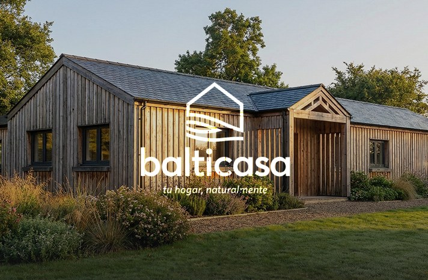

## Problema

[Borrador: qué le pasaba al cliente antes. Cómo vendía, qué no funcionaba, por qué llegó a ti.]

## Decisiones

[Borrador: por qué WooCommerce, por qué un filtro a medida en vez de un plugin, por qué móvil primero.]

## Qué construí

Tienda WooCommerce con tema a medida, filtro de catálogo por AJAX sin recargar la página y optimización para móvil.

## Qué pasó después

[Pendiente de datos.]
